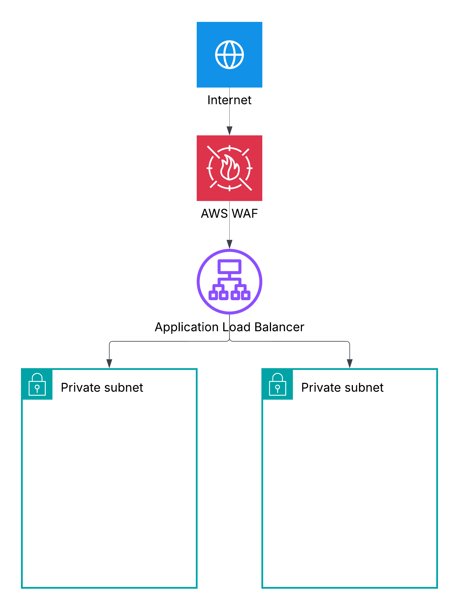
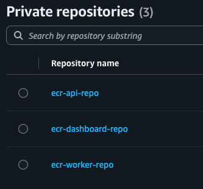
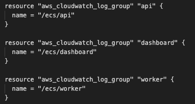

# URL Shortener - ECS Project

A URL shortener with click analytics on AWS. Three services, one cluster.

## 1. Architecture
# insert AWS diagram here

## 2. Infrastructure
In this project we made three application services and ran them on ECS using ECS fargate, all infrastructure was automated using IaC using Terraform.

Incoming Traffic from the internet is filtered through a WAF (web application firewall) so that we can block malicious HTTP/HTTPS requests before they reach the application, next they are routed using an ALB (application load balancer) which sits accross 2 public subnets; into 2 private subnets hosting our application services. The Database has a cache atatched infront of it using Amazon Redis; this is to store frequently used URLs so that they can be accessed quickly in the future.

We have 3 main App serives: our API (app), our Worker, and our dashboard. each of them is Docekrised and container images stored on Amazon ECR, and then deployed and managed using Amazon ECS on AWS fargate.

The API service: is the main entry point for the application. It accepts requests to shorten a URL, then generates the shortened URL and stores it in our database (Amazon RDS, which uses PostgreSQL). When a user clicks the shortened URL, the app retrieves the original URL and redirects the user. It also publishes click events for Amazon SQS to store the analytics.

The Worker service: this polls the Amazon SQS queue we made for click events, it then writes the analytics to the database using postgreSQL. The reason why we used a queue is so that the API doesnt have to wait for the click events to be written into the database; we can simply pass this on as a background task; this maintains the user's experience (No long wait time whilst the analytics are written).  

The Dashboard service: exposes API endpoints that allow us to query postgreSQL to retrieve and calulate analytics information. It then returns this data to the frontend allowing users to see the analytics.

| Service | Language | Port | Description |
|---------|----------|------|-------------|
| **api** | Python | 8080 | Shortens URLs, handles redirects, tracks clicks, publishes events to SQS |
| **worker** | Go | - | Polls SQS for click events, writes analytics to PostgreSQL |
| **dashboard** | Go | 8081 | Analytics API - top URLs, click stats, hourly breakdowns, recent events |

### 2a. Networking
For this project, I created a VPC across 2 availibilty zones: with 2 public and 2 private subnets. This is so that we can have high availibility, and the private subnets were created seperated from the public subnets so that our AWS services dont have internet access by default; keeping them secure and protected against unauthorised access and direct exposure to the public internet.

All of the ECS services run in private subnets, with no public IP. This is cheaper, but it also creates a networking challenge: how will the containers pull their docker images from Amazon ECR without access to the internet?

Private VPC endpoints were used to provide private access to the required AWS services without allowing public internet access (Interface endpoints were used). Using VPC endpoints reduces our NAT gateway cost (another Engineering decision to reduce cost).

security groups: security groups were used throughout to make sure that each service had __least privilege__. Components were allowed to do only their job and nothing more.

### 2b. Compute using ECS and ECS Fargate
We created an ECS cluster to host our 3 app services (api, worker, dashboard). I used ECS task definitions to define the desired number of applications that should run, for example the API service has a desired task count of 1: if it stops; ECS starts a replacement.

AWS Fargate was used to manage the underlying compute infrastructure -> this means we dont have to create the EC2 instances ourselves and manage their operating systems, patch servers, etc. with ECS Fargate; you only need to specify the resources that the container needs such as CPU and memory; and AWS ECS fargate runs the rest.

#### Setting up rolling deployments (ZERO DOWNTIME)
I configured ECS for rolling deployments; this means in a new deployment, old containers will be replaced one by one with newer versions without taking the application offline.

The configuration uses:
- Minimum healthy capacity: 100% — ECS aims to keep the existing healthy tasks running at 100% while deploying the new version.
- Maximum deployment capacity: 200% — ECS can temporarily run additional tasks during a deployment, allowing new tasks to start before old ones are stopped.
- Deployment circuit breaker with automatic rollback — if a deployment fails to reach a healthy state, ECS can roll back to the previous deployment.

### 2c. Traffic Routing
Incoming traffic is filtered through a Web Application Firewall (WAF); to block malicious HTTP/HTTPS requests before they reach the application, next they are routed using an ALB(application load balancer) to the appropriate targets. Host based routing is used to route the root domain (https://ecs-link-shortener-project) to the API, whilst (dashboard.ecs-link-shortener-project.com) routes to the dashboard.

Health checks determine whether the backend targets are healthy enough to recieve traffic.

### 2d. Messaging - SQS
Amazon SQS (Simple Queue Service) is a managed message queue. It allows for tasks to be done in the background without affecting the main application experience. 

When people click a link: we want analytics to be recorded, BUT it would be distruptive to make the user wait till the analytics are written to PostgreSQL. Instead we made an SQS queue to seperate the immediate redirect (to the shortened links URL), from the background task (writing analytics to the database).

After the click even has been published to SQS, the worker task waits for it and processes it accordingly (Go worker application service).

SQS gives us three benefits: Faster responses (to redirected URL), decoupling the API and worker, and Buffering; if clicks arrive faster than the worker processes them, the SQS queue holds the messages, waiting for the worker.

### 2e. Database using RDS PostgreSQL
Our database is  hosted using Amazon RDS, which is a fully managed relational databse service. [The engineering decision for why RDS was chosen was explained in this section](#3-engineering-decision-why-was-rds-postgresql-chosen).

### 2f. Caching using ElastiCache Redis
In order to store frequenctly accessed data, Amazon Elasticache Redis was used. This allows for the application to retrieve it faster than repeatedly fetching it from the main database. 

Redis is the caching layer between the API and the PostgreSQL Database. 

This improves performance; the cached data can be served quickly rather than fetching from the database each time, It reduces load on the database; if something is frequently accessed, it doesnt need to be retrieved every time from the database, and lastly; AWS manages the infrastructure (it is a fully managed service).

### 2g. Amazon ECR and logging
All 3 aplicaiton services are containerised using Docker, these docker images are stored in Amazon ECR (Elastic Container Registry). The ECS task definitions reference images stored in ECR.

3 cloudwatch log groups were made in terraform; these send their logging outputs to the corresponding log group (using awslogs logging driver).

### 2h. IaC using Terraform
Instead of using the AWS console to create these above resources, I used Terraform to implement them in an IAC (Infrastructure as Code) fashion.

The resources were defined in configuration files, and terraform uses those files to create the infra when needed.

The flow to set up this infrastructure using Terraform is the following:

__terraform plan__ [shows planned changes before applying] -> __terraform apply__ [will ask for confirmation then create or update the infra according to the configuration]

#### Terraform Remote State
I configured an S3 bucket for Terraform to use as its remote state. The S3 bucket was configured with:
- Versioning
- Encryption
- S3 Lockfile
This allows terraform to safely store its tfstate outside of my local machine. S3 is also encrypted at rest, and the lockfile mechanism prevents concurrent state operations.

### 2i. Security and IAM
IAM (Identity and Access Management) controls which users and services can access AWS resources and what actions they can perform. 

I used IAM roles for ECS tasks and Github Actions:
- to allow ECS to perform actions from ECR, send logs, etc.
- Application task roles, to give the 3 app services the permissions they need to access AWS resources.
- Github Actions role; to allow the CI/CD pipeline to deploy to AWS without storing long lived AWS access keys in github.

## 3. ENGINEERING DECISION: Why was RDS PostgreSQL chosen?
I chose Amazon RDS because it is a FULLY MANAGED; relational; postgreSQL based database service. Rather than Amazon DynamoDB (which is non relational). Because it is fully managed, it reduces our burden of backups, infrastructure provisioning, etc.

My data is in a relational format: the main data ill be storing is shortened URLs and click events, these would BENEFIT from being stored in a table (relational data structure) rather than a non relational database structure. Our data will be in a relational structure: one URL can have multiple clicks: these would make sense to be stored in a table format, which can then be queried using their keys.

In addition to this, our dashboard calculates top URLs (number of clicks), PostgreSQL allows us to query the data using joins, aggregations and grouping: rather than having to structure the query in terms of a specific key structure in advance.

Trade Offs: DynamoDB can be very fast; but complex queries may require additional data modelling.

Overall RDS would be the best fit for this project.

## 4. Docker

## 5. CI/CD

# 6. Deployment Worlflow

## 7. Security

## 8. Troubleshooting Problems

## 9. Local Development

### Requirements

- ECS Fargate - three separate services, one cluster
- Application Load Balancer with WAF routing to the correct service
- Database: DynamoDB or RDS PostgreSQL - you choose, you justify
- ElastiCache Redis (caching layer for the API)
- SQS queue (click events from API to worker)
- VPC with private subnets. No NAT gateways.
- GitHub Actions with OIDC. No long-lived AWS credentials.
- Zero-downtime deployments with rollback on failure
- Least-privilege IAM throughout
- Terraform with remote state
- Multi-stage Docker builds

### Deployment
You've deployed the service. Now a developer merges a PR and expects their change live within minutes - safely, with zero downtime.

<mark>Design and document the full deployment workflow in your README. Code merge to live traffic </mark>

### Deliverables

- [ ] Dockerfiles (one per service)
- [ ] Terraform for all infrastructure
- [ ] GitHub Actions CI/CD pipeline
- [ ] Deployment workflow documentation
- [ ] Working deployment - all services healthy, end-to-end flow functional
- [ ] README with your decisions, trade-offs and database justification

## Grading

- All three services running and healthy
- End-to-end flow works (shorten -> redirect -> analytics)
- Zero-downtime deployments with auto-rollback on health check failure
- No NAT gateways, no long-lived credentials, no hardcoded secrets
- Deployment workflow section present and coherent
- You can explain every resource you created

**Tear down when done.** ALB + WAF cost money even idle.

[LocalStack](https://docs.localstack.cloud/getting-started/) works for local testing of SQS.
